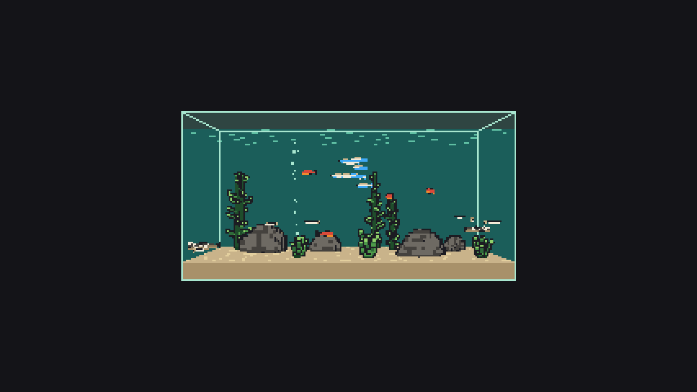

# Rapport du 2026-11-01 — cycles 114 à 121, sprint 17 → 18

**En bref :** 7 cycles clos (v1.5.2 → v1.6.1) : parallaxe immersive, rétro du sprint 17, maladie des points blancs ; c121 (eau douce lot 2, PR #371) en revue ; `main` verte, aucune alerte, 1 bug ouvert (#297, `bloque`).

## Livré
- c114 : caméra libre dans la pièce, lot 2 tactile et édition (#344, PR #353, v1.5.2)
- c115 : mode immersif lot 1, étalonnage et projection décentrée (#345, PR #354, v1.5.3)
- c116 : mode immersif lot 2, parallaxe, plein écran, Wake Lock (#346, PR #356, v1.5.4)
- c117 : dette, caméras sans allocation par image (#357, PR #358, v1.5.5)
- c118 : rétro du sprint 17, mutants de fixed-step tués (#364, PR #365, v1.5.6)
- c119 : maladie des points blancs, apparition et contagion (#360, PR #367, v1.6.0)
- c120 : points blancs visibles, alerte et lien wiki (#366, PR #369, v1.6.1)
- c121 : espèces d'eau douce lot 2, platy, danio, ancistrus, otocinclus (#362, PR #371) — en revue, pas encore fusionnée

Dernière version publiée : v1.6.1.

## À l'écran

Le bac tropical gagne de nouvelles espèces (c121, QA : verdict RÉSERVES, ancistrus et otocinclus peu reconnaissables en capture, dette #372). Les points blancs sont désormais visibles sur les poissons malades, avec une alerte de santé et un lien vers le wiki (c120, QA : peu lisibles sur les néons de face, dette #370). Depuis le rapport précédent : caméra libre tactile, mode immersif avec parallaxe à l'orientation. Captures : 105 sur 108 identiques à la série précédente.

## Cycles
| Cycle | Type | Issue | PR | Version | Résultat |
|---|---|---|---|---|---|
| 114 | fonctionnalité | #344 | #353 | v1.5.2 | livré |
| 115 | fonctionnalité | #345 | #354 | v1.5.3 | livré |
| 116 | fonctionnalité | #346 | #356 | v1.5.4 | livré |
| 117 | dette | #357 | #358 | v1.5.5 | livré |
| 118 | rétro | #364 | #365 | v1.5.6 | livré |
| 119 | fonctionnalité | #360 | #367 | v1.6.0 | livré |
| 120 | fonctionnalité | #366 | #369 | v1.6.1 | livré |
| 121 | fonctionnalité | #362 | #371 | — | revue en cours |

Chaque cycle dure de 4 h à 5 h environ ; aucune phase en échec.

## Métriques
| Indicateur | Aujourd'hui | Rapport précédent |
|---|---|---|
| Version | v1.6.1 | v1.5.1 |
| Tests unitaires | 3 504 (153 fichiers) | 3 308 |
| Couverture des lignes (tout `src`) | 97,55 % | 97,60 % |
| Lignes TypeScript de `frontend/src` | 84 450 | 78 908 |
| Bugs ouverts | 1 (#297) | 1 |
| Issues `dette` ouvertes | 53 | 52 |
| CI sur `main` | success | success |
| Mutation | 91,94 % (c103, ancien) ; pas de nouvelle mesure | 91,94 % |

## Alertes
Aucune. Les tâches planifiées `aqfish — …` sont actives, dernières exécutions réussies (Superviseur en cours). Le plafond du jour est de 8 cycles (2 démarrés). Note : la liste des tâches est paginée, seule la première page a été lue. La mesure de mutation date du cycle 103 ; le seul fichier mesuré est `care-mode.ts`.

## Décisions attendues de Mathis
Aucune PR `pret-a-fusionner` ni `validation-mathis` en attente. Issue `bloque` : #297 (fusion squash, corps vide ignoré, ligne d'attribution sur `main`) ; #330 (`validation-mathis`, joindre le paquet fond d'écran à la release) attend ta décision.
