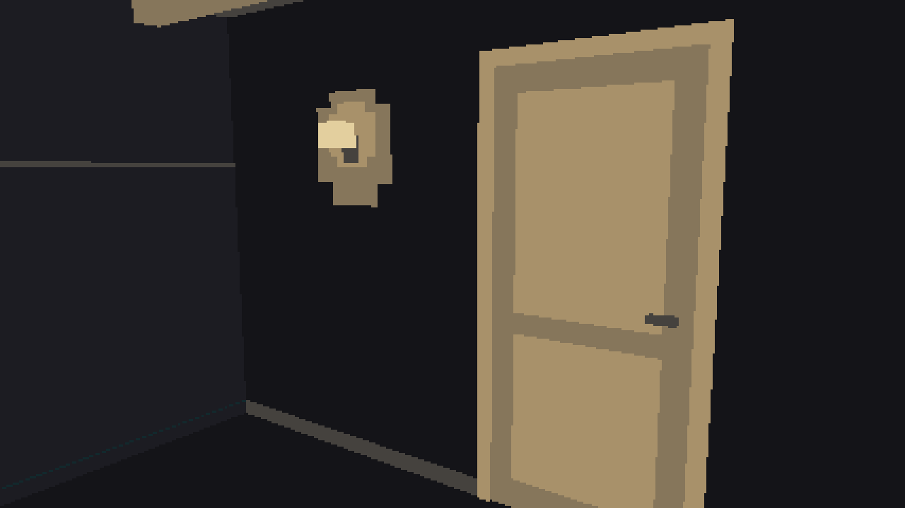

# Rapport du 2026-11-02 — cycles 122 à 128, sprint 18 → 19

**En bref :** 6 cycles clos (v1.6.3 → v1.7.1) : traitements des points blancs, immersif tactile, dette, rétro du sprint 18, lisibilité, pièce (porte, plinthes, applique) ; c128 (choix du bac en immersif, PR #389) en revue. `main` verte, aucune alerte.

## Livré
- c122 : traitements des points blancs, erreurs et guérison (#361, PR #373, v1.6.3)
- c123 : immersif, tapoter la vitre, nourrir en touchant le haut (#346, PR #376, v1.6.4)
- c124 : dette, textes des soins à part (#374, PR #378, v1.6.5)
- c125 : rétro du sprint 18, parts e2e rééquilibrées (#281, PR #383, v1.6.6)
- c126 : lisibilité des points blancs, de l'ancistrus et de la liste « Population » (#370, PR #385, v1.7.0)
- c127 : pièce, porte, plinthes, moulure, applique allumée la nuit (#363, PR #387, v1.7.1)
- c128 : choix du bac en mode immersif, tropical ou récif (#375, PR #389) — en revue

Dernière version publiée : v1.7.1.

## À l'écran

La pièce autour du bac gagne une porte à panneaux, des plinthes, une moulure et une applique qui s'allume la nuit tombante (c127, vérifié sur la capture « libre-porte-minuit » : la porte est lisible, la lumière chaude de l'applique se détache du mur sombre). Les points blancs, l'ancistrus et la liste « Population » sont plus lisibles (c126). Le mode immersif devient tactile (tapoter la vitre, nourrir) et propose bientôt le choix du bac (c128).

## Cycles
| Cycle | Type | Issue | PR | Version | Résultat |
|---|---|---|---|---|---|
| 122 | fonctionnalité | 361 | 373 | v1.6.3 | livré |
| 123 | fonctionnalité | 346 | 376 | v1.6.4 | livré |
| 124 | dette | 374 | 378 | v1.6.5 | livré |
| 125 | rétro | 281 | 383 | v1.6.6 | livré |
| 126 | fonctionnalité | 370 | 385 | v1.7.0 | livré |
| 127 | fonctionnalité | 363 | 387 | v1.7.1 | livré |
| 128 | fonctionnalité | 375 | 389 | — | en revue (QA : RÉSERVES, 0 bug) |

## Métriques
| Indicateur | Aujourd'hui | Rapport précédent |
|---|---|---|
| Tests | non mesuré (couverture > 10 min, abandonnée) | 3504 |
| Couverture lignes | non mesurée | 97,55 % |
| Lignes TS hors tests | ≈ 45 300 (mesure différente de la précédente, 84 450 tous fichiers confondus) | 84 450 |
| Bugs ouverts | 0 étiqueté `bug` | 1 |
| CI `main` | success | success |
| Mutation (c124, `treatment-text.ts`) | 94,31 %, 7 survivants (#380) | 91,94 % |

## Alertes
Aucune. Toutes les tâches `aqfish — …` sont en succès, la chaîne tourne (8 cycles/jour, plafond 8). Limite : les métriques de tests et de couverture n'ont pas pu être recalculées dans cette exécution.

## Décisions attendues de Mathis
Aucune (aucune PR `pret-a-fusionner` ou `validation-mathis`, aucune issue `bloque` ouverte).
