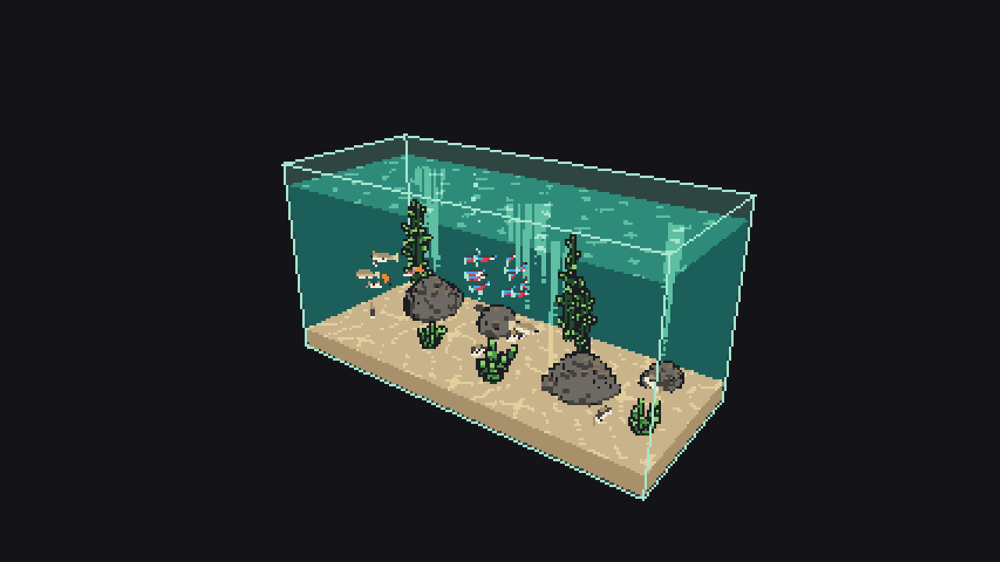
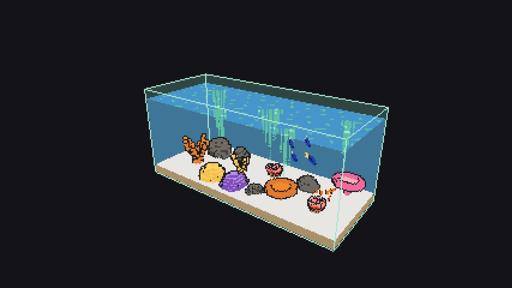

# Rapport du 2026-11-04 — cycles 136 à 142, sprint 20 → 21

**En bref :** 6 cycles clos et c142 en revue (v1.8.3 → v1.9.2) : accessibilité clavier, sons d'ambiance, sans filtre pleine résolution, étagère d'animalerie, récif lot 3, eau douce lot 4. `main` verte, aucune alerte.

## Livré
- c136 : accessibilité, clavier, focus visible, contrastes (#407, PR #410, v1.8.3)
- c137 : sons d'ambiance optionnels (#411, PR #412, v1.8.4)
- c138 : dette, limiteur et message d'indisponibilité audio (#413, PR #414, v1.8.5)
- c139 : rétro du sprint 20, « sans filtre » en pleine résolution (#415, #40, PR #417, v1.8.6)
- c140 : étagère d'animalerie à trois niveaux (#419, PR #420, v1.9.0)
- c141 : récif lot 3, crevette nettoyeuse, blennie bicolore (#422, PR #423, v1.9.1)
- c142 : eau douce lot 4, xipho, crevette cerise, néritine zèbre (#425, PR #428, v1.9.2, fusionnée ; revue en cours de clôture)

## À l'écran

Le bac tropical par défaut est identique à celui de c136 (voulu : les ajouts d'espèces n'y touchent pas). Les changements se voient dans le récif (crevette nettoyeuse, blennie, gobie et gramma plus lisibles), dans la communauté d'eau douce (xipho, crevette cerise, néritine, jugée trop petite pour être reconnue : #424) et dans la pièce (étagère d'animalerie, panneau sons et accessibilité).

## Cycles
| Cycle | Type | Issue | PR | Version | Durée dev / QA / revue | Résultat |
|---|---|---|---|---|---|---|
| 136 | fonctionnalité | #407 | #410 | v1.8.3 | 72 / 32 / 61 min | livré |
| 137 | fonctionnalité | #411 | #412 | v1.8.4 | 78 / 27 / 64 min | livré |
| 138 | dette | #413 | #414 | v1.8.5 | 80 / 80 / 62 min | livré |
| 139 | rétro | #415 | #417 | v1.8.6 | 98 / 55 / 77 min | livré |
| 140 | fonctionnalité | #419 | #420 | v1.9.0 | 158 / 52 / 70 min | livré (partiel : bacs posés non sélectionnables) |
| 141 | fonctionnalité | #422 | #423 | v1.9.1 | 83 / 36 / 66 min | livré |
| 142 | fonctionnalité | #425 | #428 | v1.9.2 | 75 / 39 / en cours | fusionnée, QA « réserves », 0 bug |

## Métriques
| Indicateur | Aujourd'hui | Rapport précédent |
|---|---|---|
| Tests unitaires | 4 014 (171 fichiers) | non relevé |
| Couverture des lignes | 97,8 % (sim : 99,3 %) | non relevée |
| Lignes TypeScript (frontend/src) | 97 303 | 92 238 |
| Bugs ouverts | 0 | 0 |
| CI sur main | succès (nouvelle exécution en cours) | succès |
| Mutation | 99,32 % (c132, dernier relevé) | 94,31 % |

## Alertes
Aucune. Chaîne active (Relance OK à 05:04, toutes les tâches `aqfish — …` en succès ou en cours). Plafond du jour : 8 cycles, 2 démarrés. Le pied d'attribution ajouté par l'environnement à la PR #428 est signalé par Dev ; aucune ligne d'attribution trouvée dans les messages de `main` sur la période.

## Décisions attendues de Mathis
Aucune (pas de PR `pret-a-fusionner` ni `validation-mathis`, pas d'issue `bloque`). Dette ouverte : #429, #424, #421.
