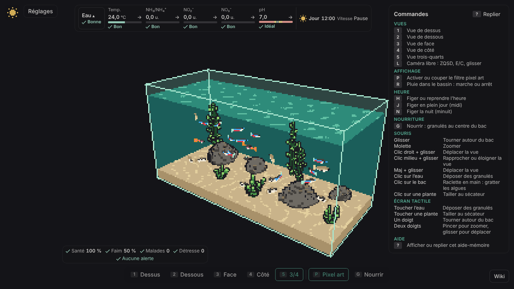

# Rapport du 2026-11-13 — cycles 202 à 209, sprint 30-31

**En bref :** 7 cycles livrés depuis le dernier rapport (v1.17.5 → v1.18.5) : rétro sprint 29, rayons de lumière, journal du bac, lampe, distributeur automatique, lot de dette du tableau de bord, dette du journal. `main` verte, aucune pause, aucune alerte bloquante.

## Livré
- c202 : rétro sprint 29, PR #587, v1.17.5
- c203 : rayons de lumière (#567), PR #589, v1.18.0 (le cycle 200 qui avait échoué est rattrapé)
- c204 : journal du bac, historique daté des événements, PR #591, v1.18.1
- c205 : lampe du bac, heure d'allumage et durée d'éclairage, PR #594, v1.18.2
- c206 : distributeur de nourriture automatique, PR #596, v1.18.3
- c207 : lot de dette du tableau de bord, PR #598, v1.18.4
- c208 : dette, hystérésis des alertes du journal et appariement des bacs, PR #601, v1.18.5
- c209 : rétro sprint 30 (#603), sprint 31 planifié (#604-#607, PR roadmap #608) ; Dev en cours sur #588

Site : https://mbensacq.github.io/aqfish/

## À l'écran

Nouveaux éléments visibles : rayons de lumière dans l'eau, tableau de bord permanent en bordure (eau, santé, simulation), bilan du bac et journal des événements, lampe réglable, distributeur de nourriture. Les séries du bac par défaut de c208 sont identiques octet pour octet à c207 (le journal est hors rendu).

## Cycles
| Cycle | Type | Issue | PR | Version | Durée (Dev / QA / Revue) | Résultat |
|---|---|---|---|---|---|---|
| 202 | rétro | #571 | #587 | v1.17.5 | 80 / 67 / 76 min | livré |
| 203 | fonctionnalité | #567 | #589 | v1.18.0 | 104 / 25 / 72 min | livré |
| 204 | fonctionnalité | #581 | #591 | v1.18.1 | 165 / 27 / 70 min | livré |
| 205 | fonctionnalité | #584 | #594 | v1.18.2 | 125 / 41 / 75 min | livré |
| 206 | fonctionnalité | #583 | #596 | v1.18.3 | 96 / 40 / 75 min | livré |
| 207 | fonctionnalité | #597 | #598 | v1.18.4 | 73 / 22 / 77 min | livré |
| 208 | dette | #599 | #601 | v1.18.5 | 65 / 38 / 71 min | livré |
| 209 | rétro | #588 | — | — | Dev en cours | en cours |

## Métriques
| Indicateur | Aujourd'hui | Rapport précédent |
|---|---|---|
| Tests unitaires | 5126 | 4986 |
| Couverture lignes | 96,69 % | 96,64 % |
| Lignes TypeScript | 128 118 | 123 971 |
| Bugs ouverts | 1 (#588) | 2 |
| CI main | verte | verte |
| Mutation | 98,16 % (c201, pas de nouvelle série) | 98,16 % |

## Alertes
- Aucune bloquante. Tâches planifiées aqfish : toutes en succès à la dernière exécution ; chaîne active, 3 cycles démarrés aujourd'hui sur 8.
- À surveiller : #600, tranches e2e à 44 min pour un plafond de 45 min.
- La PR #579 (panne apt) n'est plus ouverte.

## Décisions attendues de Mathis
Aucune.
