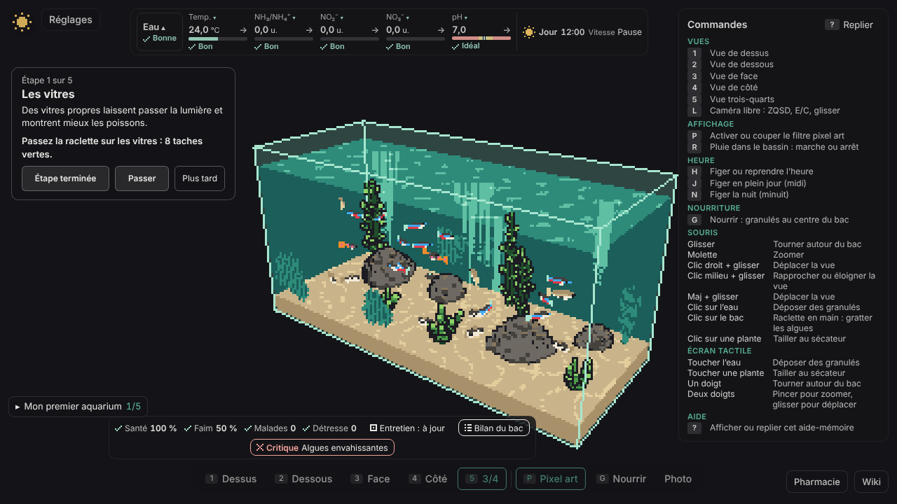
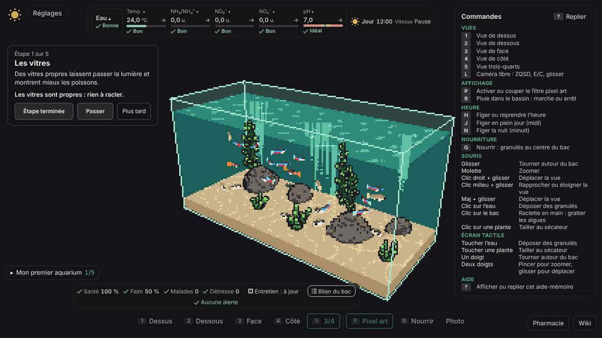

# Rapport du 2026-11-14 — cycles 209 à 214, sprint 31

**En bref :** 5 cycles livrés depuis le dernier rapport (v1.18.6 → v1.19.3) : réglages en deux colonnes, mortalité et épuisette (lot 1), séance d'entretien guidée (lot 1, raclette des vitres) et deux lots de dette. `main` verte, aucune pause ; alerte récurrente sur #600 (tranche e2e au plafond de 45 min).

## Livré
- c209 : rétro sprint 30, réglages en deux colonnes (#588), PR #609, v1.18.6
- c210 : lot de dette #611 + #610 + #602, PR #613, v1.19.0
- c211 : mortalité et épuisette, lot 1, PR #614, v1.19.1
- c212 : séance d'entretien guidée, lot 1 (raclette des vitres), PR #616, v1.19.2
- c213 : dette, suites de revue c211/c212 (algues visibles, raclette par lots, ADR 0138), PR #618, v1.19.3
- c214 : entretien lot 2 (siphon et eau neuve, #605) ; Dev en cours

Site : https://mbensacq.github.io/aqfish/

## À l'écran

Le bac par défaut (trois-quarts) est identique à la série précédente : rayons de lumière, plantes, rochers et banc de néons. Les nouveautés visibles sont dans l'interface : séance d'entretien avec raclette des vitres (captures avant / après), mortalité et épuisette, panneau de réglages sur deux colonnes. La série de c213 est partielle (143 images sur 151), les 5 angles principaux sont complets.

## Cycles
| Cycle | Type | Issue | PR | Version | Durée (Dev / QA / Revue) | Résultat |
|---|---|---|---|---|---|---|
| 209 | rétro | #588 | #609 | v1.18.6 | 72 / 59 / 87 min | livré |
| 210 | fonctionnalité | #612 | #613 | v1.19.0 | 125 / 52 / 95 min | livré |
| 211 | fonctionnalité | #582 | #614 | v1.19.1 | 94 / 26 / 113 min | livré |
| 212 | fonctionnalité | #604 | #616 | v1.19.2 | 165 / 15 / 164 min | livré |
| 213 | fonctionnalité | #617 | #618 | v1.19.3 | 140 / 41 / 152 min | livré |
| 214 | fonctionnalité | #605 | — | — | Dev en cours | en cours |

## Métriques
Couverture et nombre de tests non remesurés aujourd'hui (`npm run test:coverage` a dépassé le délai de 10 min dans l'environnement du Superviseur) : valeurs du rapport précédent reprises.

| Indicateur | Aujourd'hui | Rapport précédent |
|---|---|---|
| Tests unitaires | non remesuré (≥ 5126) | 5126 |
| Couverture lignes | non remesurée | 96,69 % |
| Lignes TypeScript | 130 519 | 128 118 |
| Bugs ouverts | 0 | 1 (#588, fermé) |
| CI main | verte | verte |
| Mutation | 98,16 % (c201, pas de nouvelle série) | 98,16 % |

## Alertes
- **#600 devient chronique** : la tranche e2e 3/7 a été annulée au plafond de 45 min aux cycles 211, 212 et 213 (0 échec de test) ; la CI n'est verte qu'après relance. Les durées de Revue montent (113, 164, 152 min contre ~75). À traiter en priorité.
- **Pied « Generated by » réinjecté** dans les descriptions de PR par l'environnement (notes de c209 à c213), contraire à CLAUDE.md. Vérifier que rien d'équivalent n'a atteint l'historique de `main`.
- Tâches planifiées aqfish : toutes en succès à la dernière exécution ; chaîne active, 2 cycles démarrés aujourd'hui sur 8.

## Décisions attendues de Mathis
Aucune.
