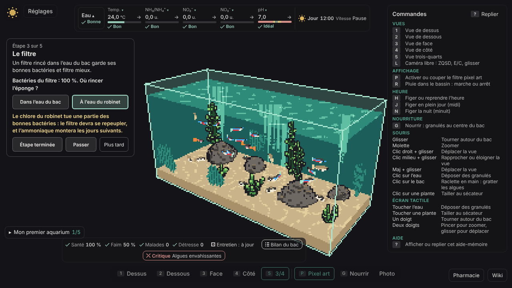

# Rapport du 2026-11-15 — cycles 214 à 220, sprint 32

**En bref :** 6 cycles livrés depuis le dernier rapport (v1.19.4 → v1.20.3) : séance d'entretien lots 2 et 3 (siphon, eau neuve, éponge du filtre), rétro du sprint 31, dette, et rééquilibrage des parts e2e (#600 résolu). `main` verte, aucune pause ; une décision attendue sur #632 (CI en 8 parts).

## Livré
- c214 : entretien lot 2, siphon et eau neuve (#605), PR #619, v1.19.4
- c215 : dette, siphon booléen et e2e de séance scindé (#620), PR #621, v1.19.5
- c216 : rétro du sprint 31, e2e du glissé tactile factorisé (#622), PR #628 (sans version)
- c217 : Playwright 1.63.0 pour les runners Ubuntu 26.04 (#629), PR #630, v1.20.1
- c218 : entretien lot 3, éponge du filtre, eau du bac ou du robinet (#606), PR #631, v1.20.2
- c219 : CI e2e, parts rééquilibrées et deux gros fichiers scindés (#600), PR #633, v1.20.3
- c220 : encrassement visible (#607) ; Dev en cours

Site : https://mbensacq.github.io/aqfish/

## À l'écran

Le bac trois-quarts est identique à la série précédente (rayons de lumière, plantes, rochers, banc de néons). Nouveauté visible : la séance d'entretien guidée progresse (étape « Le filtre » : rincer l'éponge dans l'eau du bac ou du robinet, avec avertissement sur le chlore), avec bilan du bac et indicateur « Entretien : à jour » dans la barre du bas. Série de c218 : 135 captures identiques à c217 + seance-filtre.

## Cycles
| Cycle | Type | Issue | PR | Version | Durée (Dev / QA / Revue) | Résultat |
|---|---|---|---|---|---|---|
| 214 | fonctionnalité | #605 | #619 | v1.19.4 | 102 / 42 / 153 min | livré |
| 215 | dette | #620 | #621 | v1.19.5 | 128 / 33 / 83 min | livré |
| 216 | rétro | #622 | #628 | — | 48 / 16 / 62 min | livré |
| 217 | fonctionnalité | #629 | #630 | v1.20.1 | 51 / 36 / 162 min | livré |
| 218 | fonctionnalité | #606 | #631 | v1.20.2 | 84 / 34 / 136 min | livré |
| 219 | fonctionnalité | #600 | #633 | v1.20.3 | 110 / 33 / 79 min | livré |
| 220 | fonctionnalité | #607 | — | — | Dev en cours | en cours |

## Métriques
| Indicateur | Aujourd'hui | Rapport précédent |
|---|---|---|
| Tests unitaires | 5247 (223 fichiers) | non remesuré (≥ 5126) |
| Couverture lignes | 96,16 % (sim : 99,45 %) | 96,69 % |
| Lignes TypeScript | 131 897 | 130 519 |
| Bugs ouverts | 0 | 0 |
| CI main | verte | verte |
| Mutation | 98,16 % (c201, pas de nouvelle série) | 98,16 % |

## Alertes
- **Durées de Revue encore élevées** (136 à 162 min aux cycles 217-218) ; #633 a rééquilibré les parts e2e, effet à confirmer sur les prochains cycles. Une série CI sur `main` a été annulée le 14/11 à 23:37 puis relancée avec succès.
- **Marge e2e mince** : #632 propose 8 parts au lieu de 7 (zone protégée `.github/**`), étiquetée `bloque` + `validation-mathis`.
- Tâches planifiées aqfish : toutes en succès à la dernière exécution ; chaîne active, 2 cycles démarrés aujourd'hui sur 8.

## Décisions attendues de Mathis
- #632 : passer les e2e en 8 parts dans `.github/workflows/ci.yml` (modification à faire ou fusionner par Mathis).
- PR #627 (docs roadmap, solde du sprint 31) ouverte, sans étiquette : à fusionner.
