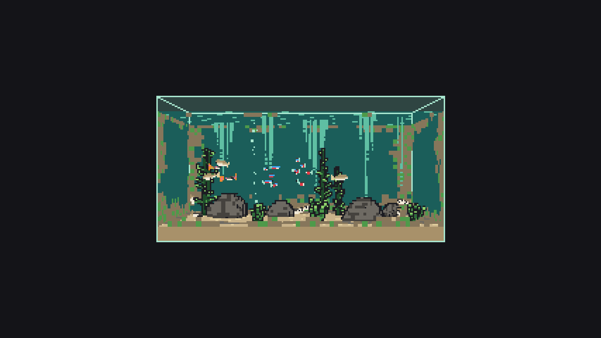

# Rapport du 2026-11-16 — cycles 221 à 228, sprint 32-33

**En bref :** 7 cycles livrés depuis le dernier rapport (v1.20.3 → v1.21.3) : encrassement visible, dette, rétro du sprint 32, puis bruitages, avant/après et lot de dette de la séance d'entretien. `main` verte, aucune pause ; une décision attendue (#632).

## Livré
- c220/221 : encrassement visible (#607, #623), PR #634, v1.20.4
- c222 : dette (#635), PR #636, v1.20.5
- c223 : rétro du sprint 32 (#637), PR #642, v1.20.6
- c224 : avant / après de la séance au bilan (#623/#624), PR #643 et #645, v1.21.0 / v1.21.1
- c225 : bruitages de la séance d'entretien (#625), PR #645/#647, v1.21.2
- c226–227 : lot de dette de la séance (#644, #646, #648), PR #649, v1.21.3
- c228 : nourriture non mangée, décomposition et pollution de l'eau (#638) ; Dev en cours

Site : https://mbensacq.github.io/aqfish/

## À l'écran

Captures non ré-examinées pixel à pixel ce jour (session limitée en temps) : la série contient les nouvelles vues d'encrassement (jour et minuit) et de la nourriture en voxels ; le bac trois-quarts de base est inchangé.

## Cycles
| Cycle | Type | Issue | PR | Version | Durée (Dev / QA / Revue) | Résultat |
|---|---|---|---|---|---|---|
| 221 | fonctionnalité | #623 | #634 | v1.20.4 | 75 / 54 / 40 min | livré |
| 222 | dette | #635 | #636 | v1.20.5 | 60 / 10 / 72 min | livré |
| 223 | rétro | #637 | #642 | v1.20.6 | 57 / 48 / 82 min | livré |
| 224 | fonctionnalité | #623 | #643 | v1.21.0 | 68 / 27 / 78 min | livré |
| 225 | fonctionnalité | #624 | #645 | v1.21.1 | 68 / 22 / 81 min | livré |
| 226 | fonctionnalité | #625 | #647 | v1.21.2 | 94 / 57 / 81 min | livré |
| 227 | fonctionnalité | #644 | #649 | v1.21.3 | 87 / 39 / 80 min | livré |
| 228 | fonctionnalité | #638 | — | — | Dev en cours | en cours |

## Métriques
| Indicateur | Aujourd'hui | Rapport précédent |
|---|---|---|
| Cycles | 8 | 7 |
| Version | v1.21.3 | v1.20.3 |
| CI main | success | success |
| Tests / couverture | non remesurés (le run de couverture a dépassé le délai) | 5247 / 96,16 % |
| Lignes TS | 134666 | 131897 |
| Mutation | 98,16 (c222) | 98,16 |

## Alertes
Aucune panne : toutes les tâches `aqfish — …` ont leur dernier run réussi ou en cours. Métriques de tests non rafraîchies (délai dépassé).

## Décisions attendues de Mathis
- #632 (`bloque`, `validation-mathis`) : CI e2e en 8 parts, toujours en attente.
