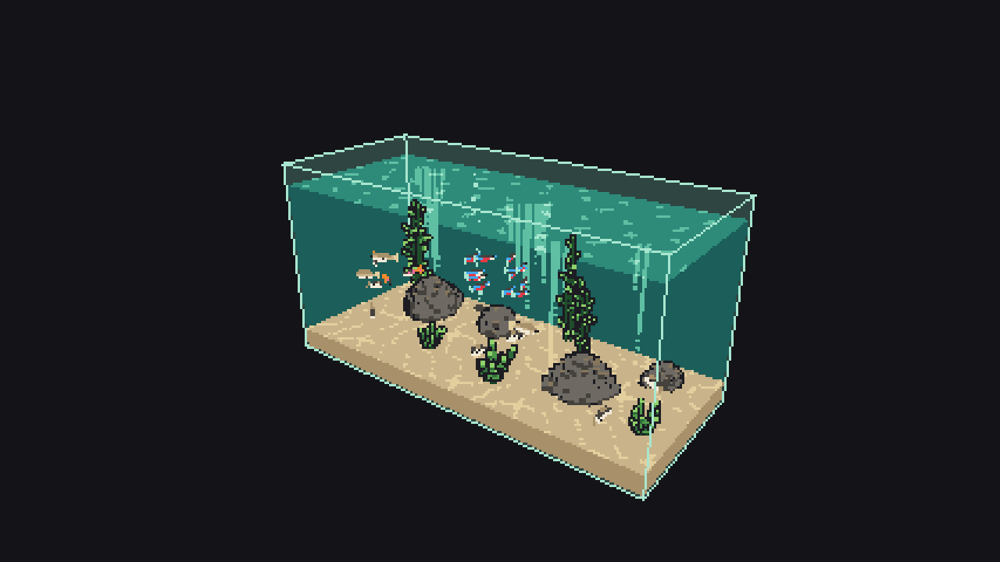

# Rapport du 2026-11-19 — cycles 243 à 251, sprint 36-37

**En bref :** 9 cycles livrés depuis le dernier rapport (v1.23.6 → v1.24.6), tous de l'assainissement du code (lots 3 à 10 sur 13) plus deux chartes en documentation ; `main` verte, aucune pause, aucune alerte bloquante. Le cycle 252 (suite du lot 10/13, #696) est en développement.

## Livré
- c243 : dette, `stepFish` et `stepWalker` en étapes (#689), PR #710, v1.23.6
- c244 : rétro, `readWater` et `healthSummary` découpés (lot 4/13, #690), PR #714, v1.23.7
- c245 : sauvegardes relues par schémas déclaratifs (lot 5/13, #691), PR #716, v1.24.0
- c246 : gardes complexes, duplications et exports inutilisés (lot 6/13, #692), PR #718, v1.24.1
- c247 : sonde des attributs de test (lot 7/13, #693), PR #719, v1.24.2
- c248 : séance d'entretien dans son contrôleur (lot 8/13, #694), PR #720, v1.24.3
- c249 : édition du décor et de la pièce dans trois contrôleurs (lot 9/13, #695), PR #735, v1.24.4
- c250 : sauvegarde, photo, boucle d'images et démarrage hors de l'hôte (lot 10/13, #696), PR #736, v1.24.5
- c251 : rétro sprint 36, suivi du bac et bacs de la pièce hors de l'hôte (lot 10/13 partiel, #696 reste ouverte), PR #738, v1.24.6
- Documentation hors cycle (PR #726 et #734) : charte d'interface « la salle d'aquarium » et plan Écosystème (capacité du bac, compatibilités), qui ont donné les issues #721 à #733 ci-dessous.

Site : https://mbensacq.github.io/aqfish/

## À l'écran

Vue trois-quarts du bac de base regardée : propre (bac, sable, plantes, rochers, banc de néons, crevettes, surface de l'eau), aucune anomalie. Aucun changement visuel sur la période : c'est de l'assainissement à comportement constant, et QA constate des captures identiques (166/166 au c251). Les changements d'apparence viendront avec les lots Interface 1/5 à 5/5 (#721 à #725) une fois l'assainissement fini.

## Cycles
| Cycle | Type | Issue | PR | Version | Durée Dev / QA / Revue (min) | Résultat |
|---|---|---|---|---|---|---|
| 243 | dette | #689 | #710 | v1.23.6 | 54 / 41 / 23 | livré |
| 244 | rétro | #690 | #714 | v1.23.7 | 32 / 17 / 28 | livré |
| 245 | fonctionnalité | #691 | #716 | v1.24.0 | 55 / 19 / 25 | livré |
| 246 | fonctionnalité | #692 | #718 | v1.24.1 | 34 / 34 / 27 | livré |
| 247 | fonctionnalité | #693 | #719 | v1.24.2 | 52 / 37 / 24 | livré |
| 248 | fonctionnalité | #694 | #720 | v1.24.3 | 42 / 46 / 27 | livré |
| 249 | fonctionnalité | #695 | #735 | v1.24.4 | 49 / 80 / 25 | livré |
| 250 | dette | #696 | #736 | v1.24.5 | 56 / 16 / 27 | livré |
| 251 | rétro | #696 | #738 | v1.24.6 | 43 / 16 / 26 | livré (partiel) |

## Métriques
| Indicateur | Aujourd'hui | Rapport précédent |
|---|---|---|
| Cycles (période) | 9 | 9 |
| Version | v1.24.6 | v1.23.5 |
| CI main | success | success |
| Tests / couverture | non mesurés (la série dépasse le délai de session) | non mesurés |
| Lignes TS (frontend/src) | 148 591 | 139 205 |
| Bugs ouverts | 0 | 0 |
| Mutation | non mesurée ; dernier score 98,16 (c229) | 98,16 |

## Alertes
- Tests et couverture non remesurés par le Superviseur pour la quatrième fois (la série de tests dépasse le délai de la session) ; l'état de la CI sur `main` fait foi. Mutation non mesurée non plus.
- Le lot 10/13 est livré en deux fois : l'hôte de l'aquarium fait encore 2 935 lignes (objectif < 1 000), d'où le cycle 252 sur #696. Restent les lots 11, 12 et 13 (#697 à #699).
- Les issues Interface 1/5 à 5/5 et Écosystème 1/7 à 7/7 (#721 à #733, `idee-mathis`) attendent la fin de l'assainissement (#686 : aucune nouvelle fonctionnalité avant). Au rythme actuel (un lot par cycle environ, 8 cycles par jour), elles démarrent dans 3 à 5 cycles.
- Un message de la Revue signale que la suppression de branche est refusée par le proxy : sans conséquence, les branches `cycle/…` s'accumulent.
- Toutes les tâches `aqfish — …` ont leur dernier run réussi ou en cours ; plafond du jour à 8, 4 cycles démarrés aujourd'hui.

## Décisions attendues de Mathis
- #632 (`bloque`, `validation-mathis`) : CI e2e en 8 parts, toujours en attente.
- Facultatif : confirmer que l'ordre voulu est bien assainissement d'abord, puis Interface et Écosystème (#686 le prévoit).
