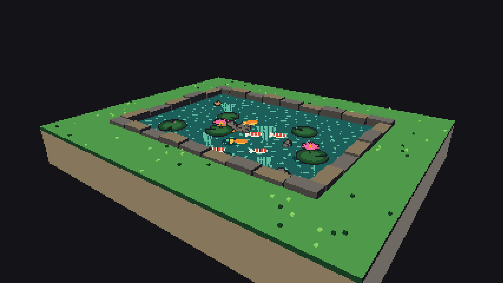

# Rapport du 2026-11-23 — cycles 276 à 284, sprint 40-41

**En bref :** 8 cycles livrés depuis le dernier rapport (v1.28.3 → v1.29.3) : masquage de l'interface, retouches, données d'écologie des espèces (eau douce, mer et eau froide, paludarium). Le cycle 284 (#793, PR #794, composés azotés en mg/L) est en QA. `main` verte, aucune pause, aucune alerte bloquante.

## Livré
- c276 : #776, PR #777, v1.28.3
- c277 : #773, PR #779, v1.28.4 (superpositions de l'interface, Pharmacie sur téléphone)
- c278 : dette #780, PR #781, v1.28.5
- c279 : rétro #768, PR #783, v1.28.6
- c280 : données d'écologie, eau douce tropicale (#784), PR #787, v1.29.0
- c281 : écologie, mer et eau froide (#785), PR #789, v1.29.1
- c282 : écologie figée et statuts des prédateurs (#788), PR #791, v1.29.2
- c283 : écologie du paludarium (#786), PR #792, v1.29.3
- c284 : mg/L et sauvegardes au schéma 3 (#793), PR #794 — en QA

Site : https://mbensacq.github.io/aqfish/

## À l'écran

Bassin à koïs regardé : propre (margelle, pelouse, nénuphars en fleur, koïs), aucune anomalie. Les cycles de la période ajoutent surtout des données de simulation (écologie par espèce) et la finition de l'interface, peu visibles à l'écran.

## Cycles
| Cycle | Type | Issue | PR | Version | Résultat |
|---|---|---|---|---|---|
| 276 | fonctionnalité | #776 | #777 | v1.28.3 | livré |
| 277 | fonctionnalité | #773 | #779 | v1.28.4 | livré |
| 278 | dette | #780 | #781 | v1.28.5 | livré |
| 279 | rétro | #768 | #783 | v1.28.6 | livré |
| 280 | fonctionnalité | #784 | #787 | v1.29.0 | livré |
| 281 | fonctionnalité | #785 | #789 | v1.29.1 | livré |
| 282 | fonctionnalité | #788 | #791 | v1.29.2 | livré |
| 283 | fonctionnalité | #786 | #792 | v1.29.3 | livré |
| 284 | fonctionnalité | #793 | #794 | — | en QA |

## Métriques
| Indicateur | Aujourd'hui | Rapport précédent |
|---|---|---|
| Version | v1.29.3 | v1.28.1 |
| CI main | success | success |
| Tests / couverture | non mesurés (installation ou run hors délai) | non mesurés |
| Lignes TypeScript (hors spec) | 76 521 | non mesuré |
| Bugs ouverts | 0 | 1 (#772) |
| Mutation | dernier c278 | c271 |

## Alertes
- Tests et couverture non remesurés (huitième fois) ; la CI verte fait foi.
- Plafond du jour : 8 ; 4 cycles démarrés aujourd'hui. Toutes les tâches `aqfish — …` : derniers runs réussis ou en cours.

## Décisions attendues de Mathis
- #632 (`bloque`, `validation-mathis`) : CI e2e en 8 parts, toujours en attente.
